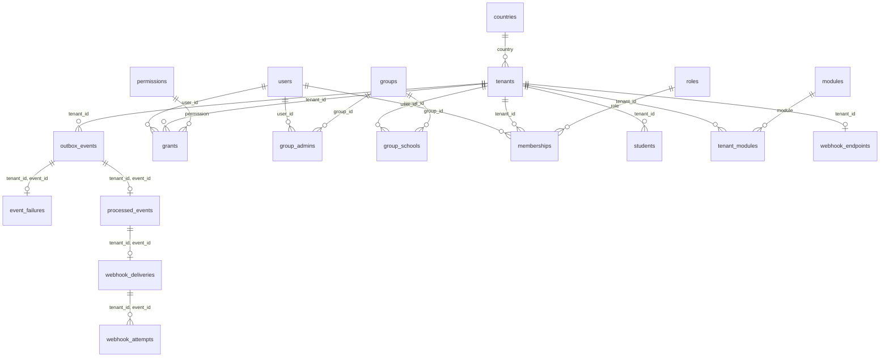
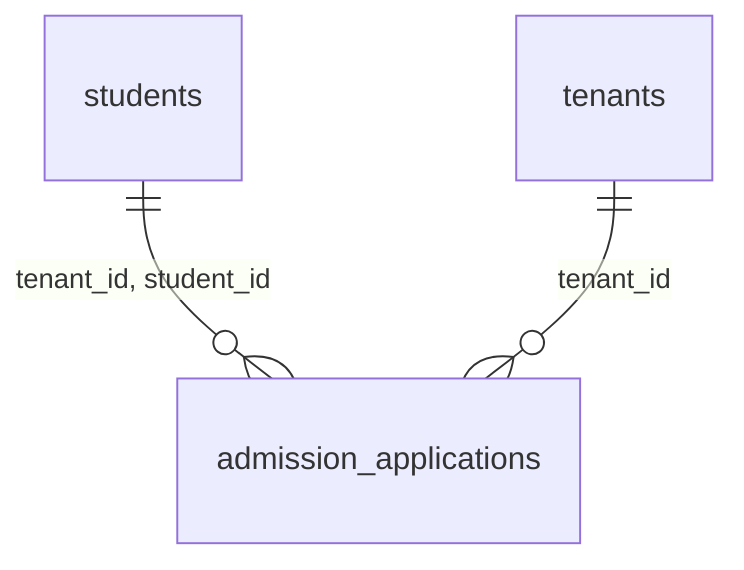
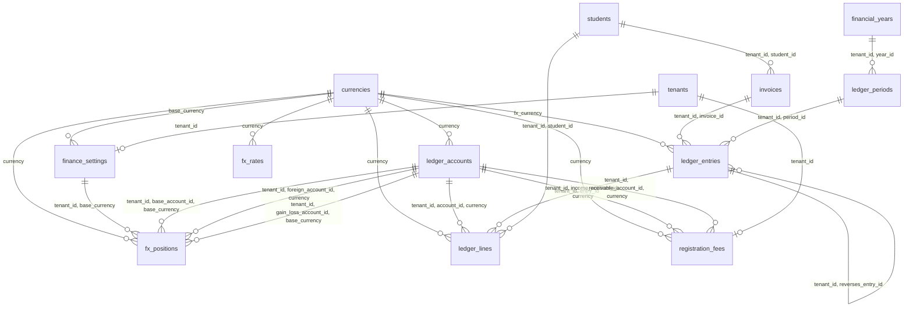
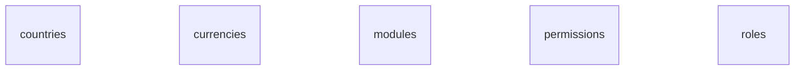
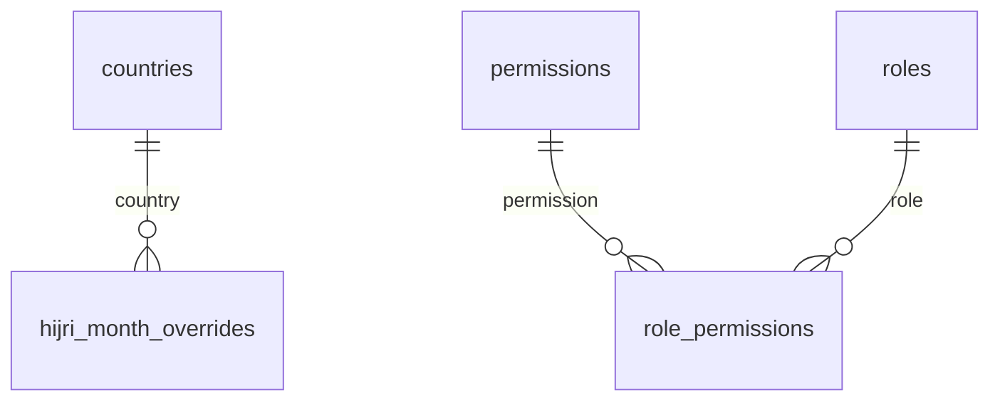

# Data model

<!-- Generated. Do not edit: run `pnpm docs:data-model`. -->

This document is generated by `pnpm docs:data-model` from the catalog of a
PostgreSQL 16 database after every migration in `db/migrations` has run.
`test/db/data-model.spec.ts` generates it again and fails when this file differs.

## How to read it

Each table has a kind:

- **core**: always on. A school cannot switch it off, and modules may refer to it.
- **module**: belongs to a module that is on or off for each school. A module refers to core tables and never to another module.
- **global catalog**: a fixed list, the same for every school, that code and foreign keys refer to. Its rows come from migrations.
- **reference**: data that is the same for every school and that only the owner role maintains.

Each table also has:

- **Key:** the primary key. A table that belongs to a school has `tenant_id` first in it.
- **References:** its foreign keys. Between two tables of a school, the key includes `tenant_id`.
- **Roles:** what each role other than the owner may do, down to the columns where the grant is by column. A role that is not listed holds nothing on the table.
- **Policies:** each row-level security policy with its command, the roles it applies to and its expressions.

The roles:

- `app_owner` owns every table and runs the migrations and the provisioning. Row-level security is forced, so the policies bind it too.
- `app_runtime` is the application and the worker's handlers.
- `app_dispatcher` reads which event belongs to which school, and nothing else.
- `app_queue` runs the job queue in its own schema, `pgboss`. The queue library creates those tables when a worker starts, so they are not in the migrations and not in this document.

In the diagrams a line runs from the table that is referenced to the table
that refers to it, and its label is the referring columns.

## Tables by kind

- **core:** `event_failures`, `grants`, `group_admins`, `group_schools`, `groups`, `memberships`, `outbox_events`, `processed_events`, `students`, `tenant_modules`, `tenants`, `users`, `webhook_attempts`, `webhook_deliveries`, `webhook_endpoints`
- **module: admissions:** `admission_applications`
- **module: finance:** `finance_settings`, `financial_years`, `fx_positions`, `fx_rates`, `invoices`, `ledger_accounts`, `ledger_entries`, `ledger_lines`, `ledger_periods`, `registration_fees`
- **global catalog:** `countries`, `currencies`, `modules`, `permissions`, `roles`
- **reference:** `hijri_month_overrides`, `role_permissions`

## Core

### event_failures

- **Kind:** core
- **Key:** `tenant_id`, `event_id`
- **References:** `outbox_events` by `tenant_id`, `event_id`
- **Row-level security:** enabled and forced
- **Roles:**
  - `app_runtime`: SELECT, INSERT (`event_id`, `error`)
- **Policies:**
  - `tenant_isolation`: ALL, all roles. USING `(tenant_id = (NULLIF(current_setting('app.tenant_id'::text, true), ''::text))::uuid)`. WITH CHECK `(tenant_id = (NULLIF(current_setting('app.tenant_id'::text, true), ''::text))::uuid)`

### grants

- **Kind:** core
- **Key:** `tenant_id`, `user_id`, `permission`
- **References:** `permissions` by `permission`; `tenants` by `tenant_id`; `users` by `user_id`
- **Row-level security:** enabled and forced
- **Roles:**
  - `app_runtime`: SELECT
- **Policies:**
  - `own_grants`: SELECT, all roles. USING `(user_id = (NULLIF(current_setting('app.user_id'::text, true), ''::text))::uuid)`
  - `provisioning`: ALL, `app_owner`. USING `true`. WITH CHECK `true`

### group_admins

- **Kind:** core
- **Key:** `group_id`, `user_id`
- **References:** `groups` by `group_id`; `users` by `user_id`
- **Row-level security:** not enabled
- **Roles:**
  - `app_runtime`: none
- **Policies:**

### group_schools

- **Kind:** core
- **Key:** `group_id`, `tenant_id`
- **References:** `groups` by `group_id`; `tenants` by `tenant_id`
- **Row-level security:** not enabled
- **Roles:**
  - `app_runtime`: none
- **Policies:**

### groups

- **Kind:** core
- **Key:** `id`
- **Row-level security:** not enabled
- **Roles:**
  - `app_runtime`: none
- **Policies:**

### memberships

- **Kind:** core
- **Key:** `tenant_id`, `user_id`
- **References:** `roles` by `role`; `tenants` by `tenant_id`; `users` by `user_id`
- **Row-level security:** enabled and forced
- **Roles:**
  - `app_runtime`: SELECT
- **Policies:**
  - `own_memberships`: SELECT, all roles. USING `(user_id = (NULLIF(current_setting('app.user_id'::text, true), ''::text))::uuid)`
  - `provisioning`: ALL, `app_owner`. USING `true`. WITH CHECK `true`

### outbox_events

- **Kind:** core
- **Key:** `tenant_id`, `id`
- **References:** `tenants` by `tenant_id`
- **Row-level security:** enabled and forced
- **Roles:**
  - `app_runtime`: SELECT, INSERT (`type`, `payload`)
  - `app_dispatcher`: SELECT (`tenant_id`, `id`, `created_at`, `dispatched_at`), UPDATE (`dispatched_at`)
- **Policies:**
  - `dispatcher_mark`: UPDATE, `app_dispatcher`. USING `(dispatched_at IS NULL)`. WITH CHECK `(dispatched_at IS NOT NULL)`
  - `dispatcher_read`: SELECT, `app_dispatcher`. USING `true`
  - `tenant_isolation`: ALL, all roles. USING `(tenant_id = (NULLIF(current_setting('app.tenant_id'::text, true), ''::text))::uuid)`. WITH CHECK `(tenant_id = (NULLIF(current_setting('app.tenant_id'::text, true), ''::text))::uuid)`

### processed_events

- **Kind:** core
- **Key:** `tenant_id`, `event_id`
- **References:** `outbox_events` by `tenant_id`, `event_id`
- **Row-level security:** enabled and forced
- **Roles:**
  - `app_runtime`: SELECT, INSERT
- **Policies:**
  - `tenant_isolation`: ALL, all roles. USING `(tenant_id = (NULLIF(current_setting('app.tenant_id'::text, true), ''::text))::uuid)`. WITH CHECK `(tenant_id = (NULLIF(current_setting('app.tenant_id'::text, true), ''::text))::uuid)`

### students

- **Kind:** core
- **Key:** `tenant_id`, `id`
- **References:** `tenants` by `tenant_id`
- **Row-level security:** enabled and forced
- **Roles:**
  - `app_runtime`: SELECT, INSERT, UPDATE
- **Policies:**
  - `tenant_isolation`: ALL, all roles. USING `(tenant_id = (NULLIF(current_setting('app.tenant_id'::text, true), ''::text))::uuid)`. WITH CHECK `(tenant_id = (NULLIF(current_setting('app.tenant_id'::text, true), ''::text))::uuid)`

### tenant_modules

- **Kind:** core
- **Key:** `tenant_id`, `module`
- **References:** `modules` by `module`; `tenants` by `tenant_id`
- **Row-level security:** enabled and forced
- **Roles:**
  - `app_runtime`: SELECT
- **Policies:**
  - `tenant_isolation`: ALL, all roles. USING `(tenant_id = (NULLIF(current_setting('app.tenant_id'::text, true), ''::text))::uuid)`. WITH CHECK `(tenant_id = (NULLIF(current_setting('app.tenant_id'::text, true), ''::text))::uuid)`

### tenants

- **Kind:** core
- **Key:** `id`
- **References:** `countries` by `country`
- **Row-level security:** enabled and forced
- **Roles:**
  - `app_runtime`: SELECT
- **Policies:**
  - `own_tenant`: SELECT, all roles. USING `(id = (NULLIF(current_setting('app.tenant_id'::text, true), ''::text))::uuid)`
  - `provisioning_insert`: INSERT, `app_owner`. WITH CHECK `true`

### users

- **Kind:** core
- **Key:** `id`
- **Row-level security:** enabled and forced
- **Roles:**
  - `app_runtime`: SELECT
- **Policies:**
  - `own_user`: SELECT, all roles. USING `(id = (NULLIF(current_setting('app.user_id'::text, true), ''::text))::uuid)`
  - `provisioning_insert`: INSERT, `app_owner`. WITH CHECK `true`

### webhook_attempts

- **Kind:** core
- **Key:** `tenant_id`, `event_id`, `attempt_no`
- **References:** `webhook_deliveries` by `tenant_id`, `event_id`
- **Row-level security:** enabled and forced
- **Roles:**
  - `app_runtime`: SELECT, INSERT
- **Policies:**
  - `tenant_isolation`: ALL, all roles. USING `(tenant_id = (NULLIF(current_setting('app.tenant_id'::text, true), ''::text))::uuid)`. WITH CHECK `(tenant_id = (NULLIF(current_setting('app.tenant_id'::text, true), ''::text))::uuid)`

### webhook_deliveries

- **Kind:** core
- **Key:** `tenant_id`, `event_id`
- **References:** `processed_events` by `tenant_id`, `event_id`
- **Row-level security:** enabled and forced
- **Roles:**
  - `app_runtime`: SELECT, INSERT, UPDATE (`status`, `finished_at`)
- **Policies:**
  - `pending_update`: UPDATE, all roles. USING `((tenant_id = (NULLIF(current_setting('app.tenant_id'::text, true), ''::text))::uuid) AND (status = 'pending'::text))`. WITH CHECK `(tenant_id = (NULLIF(current_setting('app.tenant_id'::text, true), ''::text))::uuid)`
  - `tenant_insert`: INSERT, all roles. WITH CHECK `(tenant_id = (NULLIF(current_setting('app.tenant_id'::text, true), ''::text))::uuid)`
  - `tenant_read`: SELECT, all roles. USING `(tenant_id = (NULLIF(current_setting('app.tenant_id'::text, true), ''::text))::uuid)`

### webhook_endpoints

- **Kind:** core
- **Key:** `tenant_id`
- **References:** `tenants` by `tenant_id`
- **Row-level security:** enabled and forced
- **Roles:**
  - `app_runtime`: SELECT
- **Policies:**
  - `tenant_isolation`: ALL, all roles. USING `(tenant_id = (NULLIF(current_setting('app.tenant_id'::text, true), ''::text))::uuid)`. WITH CHECK `(tenant_id = (NULLIF(current_setting('app.tenant_id'::text, true), ''::text))::uuid)`

## Module: admissions

### admission_applications

- **Kind:** module: admissions
- **Key:** `tenant_id`, `id`
- **References:** `students` by `tenant_id`, `student_id`; `tenants` by `tenant_id`
- **Row-level security:** enabled and forced
- **Roles:**
  - `app_runtime`: SELECT, UPDATE (`status`, `student_id`, `accepted_at`, `accepted_by`)
- **Policies:**
  - `tenant_isolation`: ALL, all roles. USING `(tenant_id = (NULLIF(current_setting('app.tenant_id'::text, true), ''::text))::uuid)`. WITH CHECK `(tenant_id = (NULLIF(current_setting('app.tenant_id'::text, true), ''::text))::uuid)`

## Module: finance

### finance_settings

- **Kind:** module: finance
- **Key:** `tenant_id`
- **References:** `currencies` by `base_currency`; `tenants` by `tenant_id`
- **Row-level security:** enabled and forced
- **Roles:**
  - `app_runtime`: SELECT
- **Policies:**
  - `tenant_isolation`: ALL, all roles. USING `(tenant_id = (NULLIF(current_setting('app.tenant_id'::text, true), ''::text))::uuid)`. WITH CHECK `(tenant_id = (NULLIF(current_setting('app.tenant_id'::text, true), ''::text))::uuid)`

### financial_years

- **Kind:** module: finance
- **Key:** `tenant_id`, `id`
- **Row-level security:** enabled and forced
- **Roles:**
  - `app_runtime`: SELECT, INSERT
- **Policies:**
  - `tenant_isolation`: ALL, all roles. USING `(tenant_id = (NULLIF(current_setting('app.tenant_id'::text, true), ''::text))::uuid)`. WITH CHECK `(tenant_id = (NULLIF(current_setting('app.tenant_id'::text, true), ''::text))::uuid)`

### fx_positions

- **Kind:** module: finance
- **Key:** `tenant_id`, `currency`
- **References:** `currencies` by `currency`; `finance_settings` by `tenant_id`, `base_currency`; `ledger_accounts` by `tenant_id`, `base_account_id`, `base_currency`; `ledger_accounts` by `tenant_id`, `foreign_account_id`, `currency`; `ledger_accounts` by `tenant_id`, `gain_loss_account_id`, `base_currency`
- **Row-level security:** enabled and forced
- **Roles:**
  - `app_runtime`: SELECT, INSERT
- **Policies:**
  - `tenant_isolation`: ALL, all roles. USING `(tenant_id = (NULLIF(current_setting('app.tenant_id'::text, true), ''::text))::uuid)`. WITH CHECK `(tenant_id = (NULLIF(current_setting('app.tenant_id'::text, true), ''::text))::uuid)`

### fx_rates

- **Kind:** module: finance
- **Key:** `tenant_id`, `currency`, `rate_date`
- **References:** `currencies` by `currency`
- **Row-level security:** enabled and forced
- **Roles:**
  - `app_runtime`: SELECT, INSERT
- **Policies:**
  - `tenant_isolation`: ALL, all roles. USING `(tenant_id = (NULLIF(current_setting('app.tenant_id'::text, true), ''::text))::uuid)`. WITH CHECK `(tenant_id = (NULLIF(current_setting('app.tenant_id'::text, true), ''::text))::uuid)`

### invoices

- **Kind:** module: finance
- **Key:** `tenant_id`, `id`
- **References:** `students` by `tenant_id`, `student_id`
- **Row-level security:** enabled and forced
- **Roles:**
  - `app_runtime`: SELECT, INSERT (`tenant_id`, `id`, `student_id`, `amount`, `currency`, `due_date`, `description`), UPDATE
- **Policies:**
  - `tenant_isolation`: ALL, all roles. USING `(tenant_id = (NULLIF(current_setting('app.tenant_id'::text, true), ''::text))::uuid)`. WITH CHECK `(tenant_id = (NULLIF(current_setting('app.tenant_id'::text, true), ''::text))::uuid)`

### ledger_accounts

- **Kind:** module: finance
- **Key:** `tenant_id`, `id`
- **References:** `currencies` by `currency`
- **Row-level security:** enabled and forced
- **Roles:**
  - `app_runtime`: SELECT, INSERT
- **Policies:**
  - `tenant_isolation`: ALL, all roles. USING `(tenant_id = (NULLIF(current_setting('app.tenant_id'::text, true), ''::text))::uuid)`. WITH CHECK `(tenant_id = (NULLIF(current_setting('app.tenant_id'::text, true), ''::text))::uuid)`

### ledger_entries

- **Kind:** module: finance
- **Key:** `tenant_id`, `id`
- **References:** `currencies` by `fx_currency`; `invoices` by `tenant_id`, `invoice_id`; `ledger_entries` by `tenant_id`, `reverses_entry_id`; `ledger_periods` by `tenant_id`, `period_id`
- **Row-level security:** enabled and forced
- **Roles:**
  - `app_runtime`: SELECT, INSERT
- **Policies:**
  - `tenant_isolation`: ALL, all roles. USING `(tenant_id = (NULLIF(current_setting('app.tenant_id'::text, true), ''::text))::uuid)`. WITH CHECK `(tenant_id = (NULLIF(current_setting('app.tenant_id'::text, true), ''::text))::uuid)`

### ledger_lines

- **Kind:** module: finance
- **Key:** `tenant_id`, `entry_id`, `line_no`
- **References:** `currencies` by `currency`; `ledger_accounts` by `tenant_id`, `account_id`, `currency`; `ledger_entries` by `tenant_id`, `entry_id`; `students` by `tenant_id`, `student_id`
- **Row-level security:** enabled and forced
- **Roles:**
  - `app_runtime`: SELECT, INSERT
- **Policies:**
  - `tenant_isolation`: ALL, all roles. USING `(tenant_id = (NULLIF(current_setting('app.tenant_id'::text, true), ''::text))::uuid)`. WITH CHECK `(tenant_id = (NULLIF(current_setting('app.tenant_id'::text, true), ''::text))::uuid)`

### ledger_periods

- **Kind:** module: finance
- **Key:** `tenant_id`, `id`
- **References:** `financial_years` by `tenant_id`, `year_id`
- **Row-level security:** enabled and forced
- **Roles:**
  - `app_runtime`: SELECT, INSERT, UPDATE (`status`)
- **Policies:**
  - `tenant_isolation`: ALL, all roles. USING `(tenant_id = (NULLIF(current_setting('app.tenant_id'::text, true), ''::text))::uuid)`. WITH CHECK `(tenant_id = (NULLIF(current_setting('app.tenant_id'::text, true), ''::text))::uuid)`

### registration_fees

- **Kind:** module: finance
- **Key:** `tenant_id`
- **References:** `currencies` by `currency`; `ledger_accounts` by `tenant_id`, `income_account_id`, `currency`; `ledger_accounts` by `tenant_id`, `receivable_account_id`, `currency`; `tenants` by `tenant_id`
- **Row-level security:** enabled and forced
- **Roles:**
  - `app_runtime`: SELECT
- **Policies:**
  - `tenant_isolation`: ALL, all roles. USING `(tenant_id = (NULLIF(current_setting('app.tenant_id'::text, true), ''::text))::uuid)`. WITH CHECK `(tenant_id = (NULLIF(current_setting('app.tenant_id'::text, true), ''::text))::uuid)`

## Global catalogs

### countries

- **Kind:** global catalog
- **Key:** `code`
- **Row-level security:** enabled and forced
- **Roles:**
  - `app_runtime`: SELECT
- **Policies:**
  - `provisioning`: ALL, `app_owner`. USING `true`. WITH CHECK `true`
  - `reference_read`: SELECT, all roles. USING `true`

### currencies

- **Kind:** global catalog
- **Key:** `code`
- **Row-level security:** enabled and forced
- **Roles:**
  - `app_runtime`: SELECT
- **Policies:**
  - `provisioning`: ALL, `app_owner`. USING `true`. WITH CHECK `true`
  - `reference_read`: SELECT, all roles. USING `true`

### modules

- **Kind:** global catalog
- **Key:** `key`
- **Row-level security:** not enabled
- **Roles:**
  - `app_runtime`: none
- **Policies:**

### permissions

- **Kind:** global catalog
- **Key:** `key`
- **Row-level security:** not enabled
- **Roles:**
  - `app_runtime`: none
- **Policies:**

### roles

- **Kind:** global catalog
- **Key:** `key`
- **Row-level security:** not enabled
- **Roles:**
  - `app_runtime`: none
- **Policies:**

## Reference data

### hijri_month_overrides

- **Kind:** reference
- **Key:** `country`, `hijri_year`, `hijri_month`
- **References:** `countries` by `country`
- **Row-level security:** enabled and forced
- **Roles:**
  - `app_runtime`: SELECT
- **Policies:**
  - `provisioning`: ALL, `app_owner`. USING `true`. WITH CHECK `true`
  - `reference_read`: SELECT, all roles. USING `true`

### role_permissions

- **Kind:** reference
- **Key:** `role`, `permission`
- **References:** `permissions` by `permission`; `roles` by `role`
- **Row-level security:** enabled and forced
- **Roles:**
  - `app_runtime`: SELECT
- **Policies:**
  - `provisioning`: ALL, `app_owner`. USING `true`. WITH CHECK `true`
  - `reference_read`: SELECT, all roles. USING `true`
